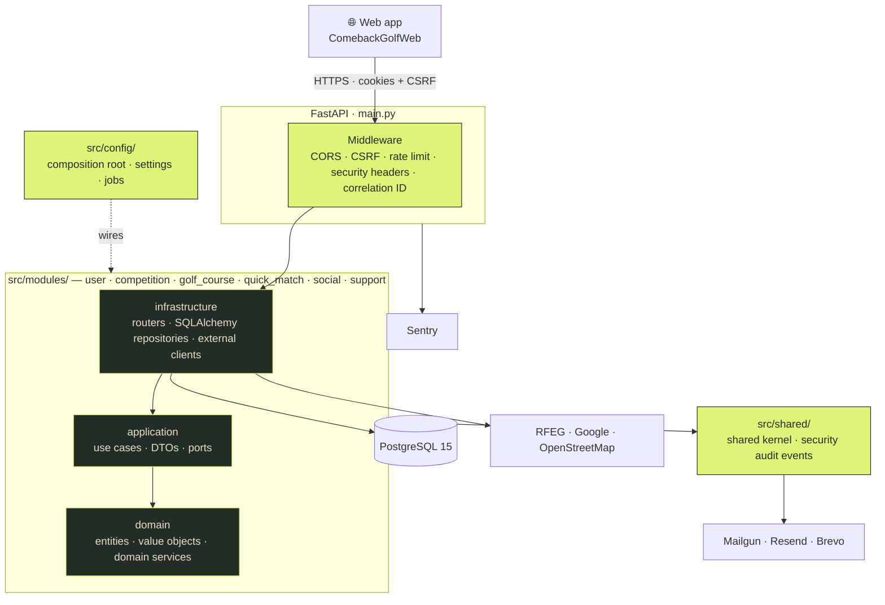
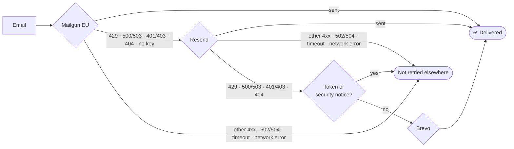

<div align="center">

<a href="https://www.comebackgolf.com">
  <picture>
    <source media="(prefers-color-scheme: dark)" srcset="https://www.comebackgolf.com/brand/wordmark-acid.svg">
    <source media="(prefers-color-scheme: light)" srcset="https://www.comebackgolf.com/brand/wordmark-deep.svg">
    
  </picture>
</a>

### Golf among friends — the API behind it

Ryder-style team tournaments, quick rounds and hole-by-hole scoring for amateur golfers.

[](CHANGELOG.md)
[](https://github.com/agustinEDev/ComebackGolfApi/actions/workflows/ci_cd_pipeline.yml)
[](tests/README.md)
[](docs/ci-cd/PIPELINE_GUIDE.md)

[](requirements.txt)
[](requirements.txt)
[](requirements.txt)
[](docker/docker-compose.yml)
[](LICENSE)

[**Web app**](https://www.comebackgolf.com) ·
[**Frontend repo**](https://github.com/agustinEDev/ComebackGolfWeb) ·
[**API reference**](docs/API.md) ·
[**Docs**](docs/README.md) ·
[**Changelog**](CHANGELOG.md)

</div>

---

## ⛳ What it is

**Comeback Golf** is an app for amateur golfers who play with their friends: organise a
tournament in the Ryder-style team format (or Stableford and Medal), invite players,
draft the teams, score every hole from the course and follow the standings live. Or
skip the tournament and start a quick round in seconds.

This repository is the **backend**: a FastAPI REST API, built with Clean Architecture and
Domain-Driven Design, that serves the web app at
[www.comebackgolf.com](https://www.comebackgolf.com) from `https://api.comebackgolf.com`.

| | |
|---|---|
| 🔌 **213** operations in the OpenAPI schema | 🧪 **13,000+** tests (unit, integration, security) |
| 🧱 **6** bounded contexts + a shared kernel | 📜 **50** Architecture Decision Records |

> **History.** This project had another name until November 2026. Issue and PR numbers
> written before the new repositories (`BE #N`, `FE #N`) refer to the archived
> repositories.

---

## 🧩 What's inside

| | Module | What it does |
|---|---|---|
| 👤 | **`user`** | Sign-up with email verification, sign-in with httpOnly cookies, Google sign-in, password reset, email change, devices, handicap (RFEG lookup or manual), avatars and photo uploads (HEIC included), player stats, terms acceptance, admin panel |
| 🏆 | **`competition`** | Tournaments in Ryder-style team format (`RYDER_CUP`), Stableford and Medal · lifecycle `DRAFT → ACTIVE → CLOSED → IN_PROGRESS → COMPLETED` with backward steps · enrollments, invitations, waiting lists, automatic enrollment closing · teams, captains, draft and envelopes · rounds and matches (Singles, Fourball, Foursomes) · stroke-play tee groups · hole-by-hole scoring, standings and leaderboard |
| ⛳ | **`golf_course`** | Courses with tees and holes, requests reviewed by an admin, import of the Spanish federation's courses, hole maps matched from OpenStreetMap |
| ⚡ | **`quick_match`** | Rounds outside a tournament: friends and guests without an account, delegated scorers, auto-close of abandoned rounds, hide and delete, stats exclusion |
| 🤝 | **`social`** | Friends and blocking, public profiles, photo gallery, friends' activity feed and achievements |
| ✉️ | **`support`** | Contact form delivered to the app's mailbox |
| 🧱 | **`shared`** | The kernel every module uses: playing-handicap and match-play rules, email delivery, HTTP middleware, security, persistence |
| ⚙️ | **`config`** | Composition root: settings, dependency wiring, rate limits, CSRF, startup safety checks and background jobs |

---

## 🏛️ Architecture

Each module is split into three layers, and the dependency rule only points inwards:
**infrastructure → application → domain**. The domain imports no framework. The rules
are not a convention: 19 [`import-linter`](.importlinter) contracts and the tests in
`tests/unit/architecture/` break the build if a layer or a module reaches where it
should not.



Patterns in play: repositories and unit of work, value objects, ports and adapters,
dependency injection through FastAPI `Depends`, and use cases that call
the port responsible for each side effect explicitly (ADR-050). Persistence uses
SQLAlchemy imperative mapping, so entities stay plain Python. More in
[docs/design-document.md](docs/design-document.md) and
[docs/project-structure.md](docs/project-structure.md).

### ✉️ How an email leaves



The next provider is tried only after a 429, a 500/503 (any 5xx except 502/504), a
rejected key (401/403) or a 404 (misconfigured account). After any other 4xx, a 502/504,
a timeout or a network error it is not: the email may already be out, or would be
refused anyway. Brevo only sends emails without a token: those that carry one
(verification, password reset, email change) and security notices never go through it,
because it rewrites links. Locally and in Kind, `EMAIL_TRANSPORT=mailpit` keeps everything in a local
inbox.

---

## 🛠️ Stack

| Area | Technology |
|---|---|
| Language | Python 3.12 · 3.14 (production image `python:3.14-slim`) |
| Web | FastAPI 0.162 · Starlette 1.10 · Uvicorn 0.54 · Pydantic 2 |
| Data | PostgreSQL 15 · SQLAlchemy 2.1 (async, imperative mapping) · asyncpg · Alembic |
| Security | PyJWT (HS256) · bcrypt · slowapi · secure (security headers) |
| Geo | Shapely · geojson-pydantic · tzfpy (course time zones) |
| Images | Pillow · pillow-heif |
| Observability | Sentry · structured security audit log · correlation IDs |
| Quality | pytest · pytest-xdist · Ruff · mypy · import-linter |
| Delivery | Docker · GitHub Actions · Render |

Exact pins live in [`requirements.txt`](requirements.txt) and
[`requirements-dev.txt`](requirements-dev.txt); the image installs the hashed
[`requirements.lock`](requirements.lock).

---

## 🚀 Quick start

**With Docker Compose** (PostgreSQL + API + Mailpit):

```bash
git clone https://github.com/agustinEDev/ComebackGolfApi.git
cd ComebackGolfApi
cp docker/.env.example docker/.env          # fill in the values
docker compose -f docker/docker-compose.yml --env-file docker/.env up -d --build
curl -s http://localhost:8000/health
```

| | |
|---|---|
| API | `http://localhost:8000` (`DOCKER_APP_PORT`; 8001 if unset) |
| Interactive docs | `http://localhost:8000/docs` (HTTP Basic: `DOCS_USERNAME` / `DOCS_PASSWORD`) |
| Test inbox | `http://127.0.0.1:8025` |

Migrations run on start-up (`entrypoint.sh`).

**Without Docker for the API:**

```bash
python3.12 -m venv .venv && source .venv/bin/activate
pip install -r requirements-dev.txt         # includes requirements.txt
cp .env.example .env                        # point DATABASE_URL at a PostgreSQL (postgresql://)
# In .env set EMAIL_TRANSPORT=mailpit (the example says mailgun: real emails)
docker compose -f docker/docker-compose.yml --env-file docker/.env up -d mailpit   # inbox on http://127.0.0.1:8025
alembic upgrade head
uvicorn main:app --reload
```

**Full stack on Kubernetes (Kind)**, with the frontend cloned next to this repo:

```bash
./k8s/scripts/deploy-cluster.sh             # API on :8000, web on :8080
```

See [k8s/README.md](k8s/README.md), [docker/README.md](docker/README.md) and
[DEPLOYMENT.md](DEPLOYMENT.md).

---

## 🧪 Tests

```bash
pytest tests/unit/                 # 11,258 tests, no database
pytest tests/integration/          #  1,737 tests, needs PostgreSQL
pytest tests/security -n 2         #     67 tests: CSRF, XSS, SQLi, auth bypass, rate limits
```

Counts from `pytest --collect-only` on v2.82.0. Tests run in parallel by default
(`-n auto`), and every integration test gets its own throw-away database. Details in
[tests/README.md](tests/README.md).

---

## 🔐 Security and quality

**In the application**

- 🍪 Sessions in **httpOnly cookies** (15-minute access token, 7-day refresh token); no
  bearer tokens.
- 🛡️ **CSRF**: signed token bound to the session, sent as `X-CSRF-Token` and checked
  against its cookie.
- 🚦 **Rate limiting**: stricter limits on sensitive routes and a default of 100/min per
  user for every session route without its own (a few are explicitly exempt), keyed on
  the verified user or the real client IP behind Cloudflare (ADR-038, ADR-041).
- 🔑 **Login brake** per email and network, plus an account-wide backstop (ADR-043);
  bcrypt with 12 rounds; the last 5 passwords cannot be reused.
- 🔗 Email links are stored hashed and expire (verification 48 h, password reset 1 h).
- 🧾 Security headers (HSTS, CSP, `X-Frame-Options`, `nosniff`, referrer policy,
  `no-store`), upload size caps,
  docs behind HTTP Basic, and a start-up check that refuses to run with an unsafe
  configuration (weak `SECRET_KEY`, malformed cookie domain, missing CORS origins…).
- 🔭 Security audit log, correlation IDs on every response and Sentry.

**In the pipeline** ([guide](docs/ci-cd/PIPELINE_GUIDE.md))

| Check | Tool |
|---|---|
| Lint, format, types | Ruff · mypy |
| Architecture | import-linter (19 contracts) |
| API contract | oasdiff against the base branch |
| OWASP Top 10 | Semgrep (`p/owasp-top-ten`, `p/python`) |
| Code and dependencies | Bandit · pip-audit · Dependency Review · weekly Snyk |
| Secrets | Gitleaks over the whole history |
| Image | Trivy · start-up exactly like Render |
| Supply chain | Hash-pinned locks · CycloneDX SBOM · GPG-signed commits |
| Tests | Unit, integration and security on Python 3.12 and 3.14; coverage floor 88 % |

Threat model: [docs/security/THREAT_MODEL.md](docs/security/THREAT_MODEL.md) ·
accepted risks: [docs/KNOWN_SECURITY_ISSUES.md](docs/KNOWN_SECURITY_ISSUES.md).

---

## 📚 Documentation

| | |
|---|---|
| [docs/API.md](docs/API.md) | Endpoint reference, auth, CSRF, rate limits |
| [docs/design-document.md](docs/design-document.md) | Design and architecture |
| [docs/DATABASE_ERD.md](docs/DATABASE_ERD.md) | Data model |
| [docs/architecture/decisions/](docs/architecture/decisions/) | Architecture Decision Records |
| [docs/MULTI_ENVIRONMENT_SETUP.md](docs/MULTI_ENVIRONMENT_SETUP.md) | Environment variables per environment |
| [DEPLOYMENT.md](DEPLOYMENT.md) · [docs/RUNBOOK.md](docs/RUNBOOK.md) | Deployment and operations |
| [ROADMAP.md](ROADMAP.md) · [CHANGELOG.md](CHANGELOG.md) | What exists, what's next, what changed |
| [docs/README.md](docs/README.md) | Full index |

---

## 🤝 Contributing

Branches follow GitFlow (`feature/*` → `develop` → `release/*` → `main`), every commit
must be GPG-signed, and a pull request needs the whole pipeline green. Production
deploys automatically when `main` moves.

## 📄 License

Copyright © 2025-2026 Agustín Estévez Domínguez. **All rights reserved.** The source code
is published for viewing only; no licence is granted to use, copy, modify or distribute it
without the author's written permission. See [LICENSE](LICENSE).

## 📬 Contact

[hola@comebackgolf.com](mailto:hola@comebackgolf.com) ·
[Report an issue](https://github.com/agustinEDev/ComebackGolfApi/issues)

<div align="center">
<br>
<sub>Built for the golfers who always ask for one more round.</sub>
</div>
