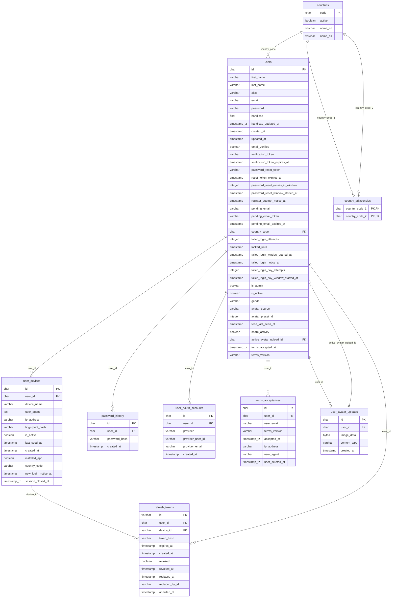
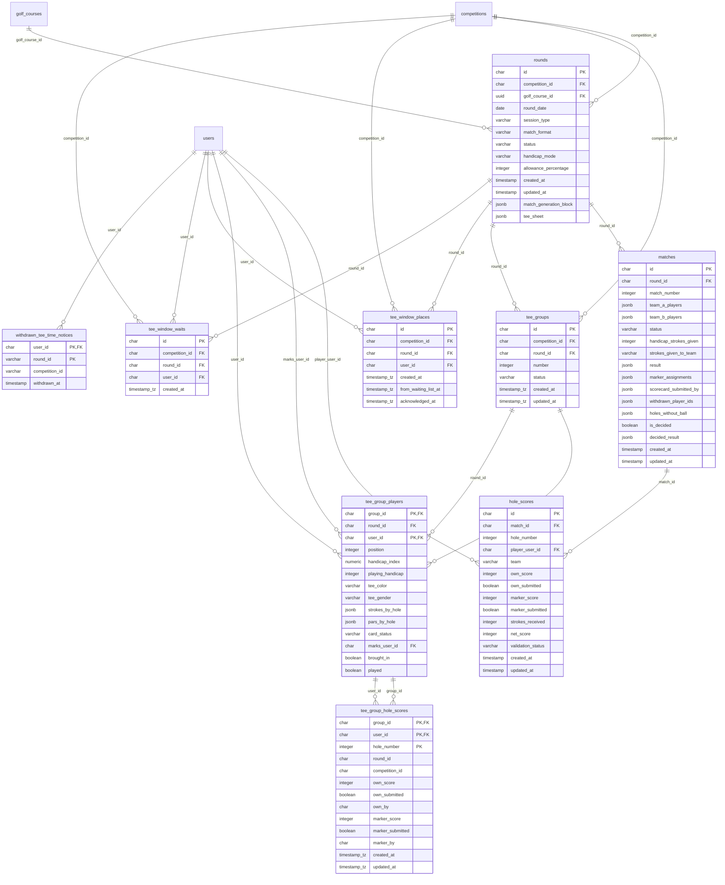
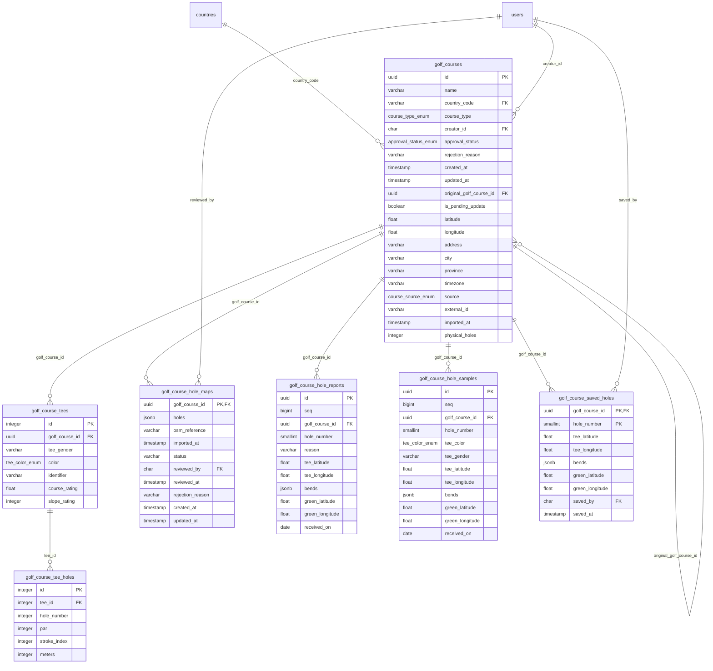
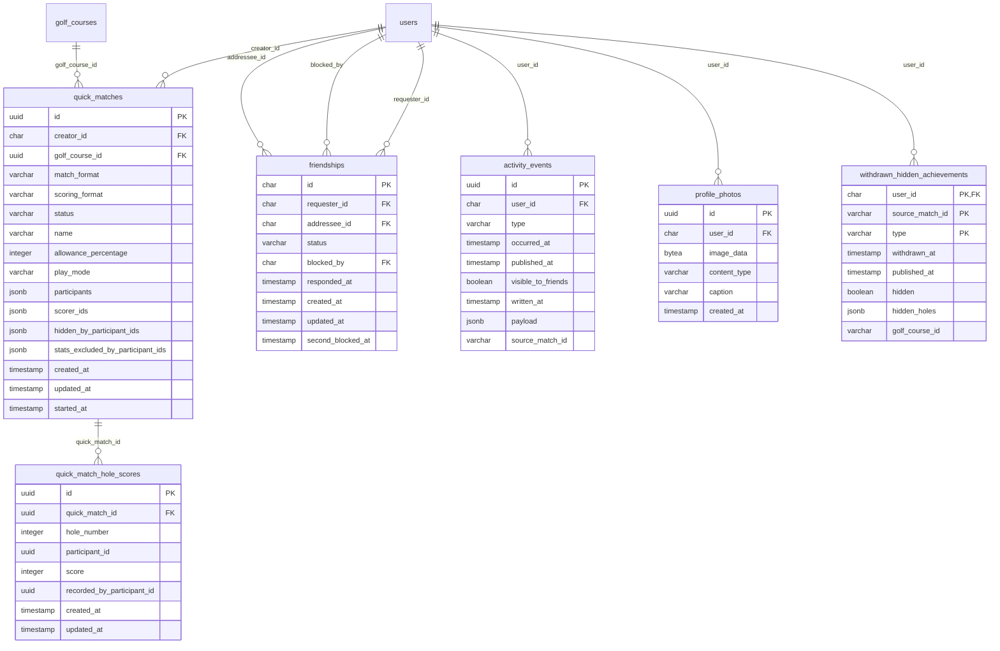

# 🗄️ Database Entity Relationship Diagram (ERD)

> **Version:** 2.82.2
> **Last updated:** 28 November 2026
> **Database:** PostgreSQL 15 (the image used by `docker/docker-compose.yml`, the Kind cluster and the CI integration job)

---

## Source of truth

This document is a **snapshot**. The schema lives in code:

- **SQLAlchemy imperative mappers** (`src/modules/*/infrastructure/persistence/sqlalchemy/` and `src/shared/infrastructure/persistence/sqlalchemy/`), registered on one `MetaData` in `src/shared/infrastructure/persistence/sqlalchemy/base.py`.
- **Alembic migrations** (`alembic/versions/`), which build the production schema. `alembic/env.py` uses the same `MetaData` as `target_metadata`.
- `tests/integration/test_schema_parity.py` checks that the schema built by the mappers and the one built by the migrations match.

The diagrams below were generated from that `MetaData` (**44 tables**). Column types are the PostgreSQL types SQLAlchemy compiles (`char` = fixed-length string ids, `timestamp_tz` = `timestamp with time zone`, `*_enum` = PostgreSQL enum types). Foreign keys are drawn as one-to-many; uniqueness, check constraints and indexes are not shown: read the mappers and migrations for those.

To regenerate a table list from the code:

```bash
ENVIRONMENT=development python -c "import main; from src.shared.infrastructure.persistence.sqlalchemy.base import metadata; print(sorted(metadata.tables))"
```

---

## Tables by area

| Area | Tables |
|------|--------|
| Users, sessions and accounts (user module, shared countries) | `users`, `user_devices`, `refresh_tokens`, `password_history`, `user_oauth_accounts`, `terms_acceptances`, `user_avatar_uploads`, `countries`, `country_adjacencies` |
| Competitions: setup, enrollment and teams | `competitions`, `competition_golf_courses`, `competition_course_tees`, `enrollments`, `enrollment_course_tees`, `invitations`, `team_assignments`, `drafts`, `envelopes`, `handicap_updates`, `handicap_refreshes`, `handicap_update_schedules`, `handicap_update_emails` |
| Competitions: rounds, matches and scoring | `rounds`, `matches`, `hole_scores`, `tee_groups`, `tee_group_players`, `tee_group_hole_scores`, `tee_window_places`, `tee_window_waits`, `withdrawn_tee_time_notices` |
| Golf courses and hole maps | `golf_courses`, `golf_course_tees`, `golf_course_tee_holes`, `golf_course_hole_maps`, `golf_course_hole_reports`, `golf_course_hole_samples`, `golf_course_saved_holes` |
| Quick matches and social | `quick_matches`, `quick_match_hole_scores`, `friendships`, `activity_events`, `profile_photos`, `withdrawn_hidden_achievements` |

Notes:

- **Match play** (Ryder format) scoring is stored per player and hole in `hole_scores` (match `matches`). **Stroke play** (Stableford and Medal) scores by tee group: `tee_groups` → `tee_group_players` → `tee_group_hole_scores`.
- Several aggregates keep lists as `jsonb` instead of join tables (for example `matches.team_a_players`, `team_assignments.team_a_player_ids`, `quick_matches.participants`, `drafts.picks`).
- Profile photos and uploaded avatars are stored in the database (`bytea`), not on disk.

---

## Diagrams

Tables that belong to another area appear without columns.

### Users, sessions and accounts



### Competitions: setup, enrollment and teams

```mermaid
erDiagram
    competitions {
        char id PK
        char creator_id FK
        varchar name
        date start_date
        date end_date
        char country_code FK
        char secondary_country_code FK
        char tertiary_country_code FK
        varchar team_1_name
        varchar team_2_name
        varchar play_mode
        integer max_players
        varchar team_assignment
        varchar status
        integer max_playing_handicap
        integer enrollment_opens_days_before
        timestamp enrollment_opened_at
        boolean enrollment_closed_by_deadline
        boolean enrollment_close_blocked_notified
        varchar visibility
        varchar setup_mode
        varchar tournament_type
        numeric_array stroke_category_limits
        integer stroke_max_matchdays_per_player
        varchar stroke_overall_standing
        integer stroke_category_count
        char team_a_captain_id FK
        char team_b_captain_id FK
        char team_a_vice_captain_id FK
        char team_b_vice_captain_id FK
        timestamp created_at
        timestamp updated_at
    }
    competition_golf_courses {
        char id PK
        char competition_id FK
        uuid golf_course_id FK
        integer display_order
        timestamp created_at
    }
    competition_course_tees {
        char competition_id PK, FK
        uuid golf_course_id PK, FK
        varchar gender PK
        varchar tee_color
        timestamp_tz updated_at
    }
    enrollments {
        char id PK
        char competition_id FK
        char user_id FK
        varchar status
        varchar team_id
        numeric custom_handicap
        varchar tee_color
        boolean use_real_name
        numeric fixed_handicap
        integer fixed_category
        boolean entered_waiting
        timestamp created_at
        timestamp updated_at
    }
    enrollment_course_tees {
        char enrollment_id PK, FK
        uuid golf_course_id PK, FK
        varchar tee_color
        timestamp_tz updated_at
    }
    invitations {
        char id PK
        char competition_id FK
        char inviter_id FK
        varchar invitee_email
        char invitee_user_id FK
        varchar status
        text personal_message
        timestamp expires_at
        timestamp responded_at
        timestamp created_at
        timestamp updated_at
        boolean sent_by_email
    }
    team_assignments {
        char id PK
        char competition_id FK
        varchar mode
        jsonb team_a_player_ids
        jsonb team_b_player_ids
        timestamp created_at
    }
    drafts {
        char id PK
        char competition_id FK
        char team_a_captain_id FK
        char team_b_captain_id FK
        varchar status
        varchar first_pick
        varchar current_team
        timestamp turn_started_at
        jsonb picks
        integer seconds_per_turn
    }
    envelopes {
        char id PK
        char competition_id FK
        char round_id FK
        varchar team
        varchar match_format
        jsonb entries
        timestamp submitted_at
        char submitted_by FK
        boolean automatic
        boolean revealed
        boolean reveal_when_both_ready
    }
    handicap_updates {
        char id PK
        char competition_id FK
        varchar origin
        varchar status
        timestamp_tz created_at
        timestamp_tz finished_at
        timestamp_tz resumed_at
    }
    handicap_refreshes {
        char update_id PK, FK
        char user_id PK, FK
        varchar result
        integer attempts
        timestamp_tz refreshed_at
    }
    handicap_update_schedules {
        char competition_id PK, FK
        timestamp_tz run_at
        timestamp_tz created_at
    }
    handicap_update_emails {
        char competition_id PK, FK
        char user_id PK, FK
        varchar kind PK
        varchar fingerprint
        timestamp_tz sent_at
    }
    competitions ||--o{ competition_course_tees : "competition_id"
    competitions ||--o{ competition_golf_courses : "competition_id"
    competitions ||--o{ drafts : "competition_id"
    competitions ||--o{ enrollments : "competition_id"
    competitions ||--o{ envelopes : "competition_id"
    competitions ||--o{ handicap_update_emails : "competition_id"
    competitions ||--o{ handicap_update_schedules : "competition_id"
    competitions ||--o{ handicap_updates : "competition_id"
    competitions ||--o{ invitations : "competition_id"
    competitions ||--o{ team_assignments : "competition_id"
    countries ||--o{ competitions : "country_code"
    countries ||--o{ competitions : "secondary_country_code"
    countries ||--o{ competitions : "tertiary_country_code"
    enrollments ||--o{ enrollment_course_tees : "enrollment_id"
    golf_courses ||--o{ competition_course_tees : "golf_course_id"
    golf_courses ||--o{ competition_golf_courses : "golf_course_id"
    golf_courses ||--o{ enrollment_course_tees : "golf_course_id"
    handicap_updates ||--o{ handicap_refreshes : "update_id"
    rounds ||--o{ envelopes : "round_id"
    users ||--o{ competitions : "creator_id"
    users ||--o{ competitions : "team_a_captain_id"
    users ||--o{ competitions : "team_a_vice_captain_id"
    users ||--o{ competitions : "team_b_captain_id"
    users ||--o{ competitions : "team_b_vice_captain_id"
    users ||--o{ drafts : "team_a_captain_id"
    users ||--o{ drafts : "team_b_captain_id"
    users ||--o{ enrollments : "user_id"
    users ||--o{ envelopes : "submitted_by"
    users ||--o{ handicap_refreshes : "user_id"
    users ||--o{ handicap_update_emails : "user_id"
    users ||--o{ invitations : "invitee_user_id"
    users ||--o{ invitations : "inviter_id"
```



### Competitions: rounds, matches and scoring



### Golf courses and hole maps



### Quick matches and social



---

## 🔗 References

- [ADR-005: Repository pattern](architecture/decisions/ADR-005-repository-pattern.md)
- [ADR-010: Alembic for database migrations](architecture/decisions/ADR-010-alembic-for-database-migrations.md)
- [ADR-018: Automated database migrations in production](architecture/decisions/ADR-018-automated-database-migrations.md)
- [ADR-037: Two-tier handicap architecture and session-based round model](architecture/decisions/ADR-037-two-tier-handicap-session-round-model.md)
