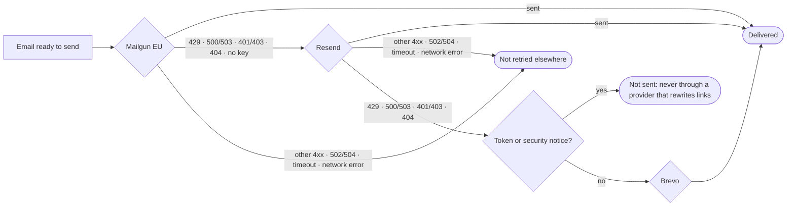

# 🌍 Multi-Environment Setup - ComebackGolfApi

The same code runs in three places. What changes is configuration, read from
environment variables (`src/config/settings.py` and the modules next to it). The
complete list, commented, is in [`.env.example`](../.env.example).

| Environment | API | Frontend | Email |
|-------------|-----|----------|-------|
| **Local (Docker Compose)** | `http://localhost:8000` (8001 if `DOCKER_APP_PORT` is unset) | `http://localhost:5173` (Vite, run from the frontend repo) | Mailpit, `http://127.0.0.1:8025` |
| **Local (Kind)** | `http://localhost:8000` | `http://localhost:8080` | Mailpit inside the cluster |
| **Production (Render)** | `https://api.comebackgolf.com` | `https://www.comebackgolf.com` | Mailgun (EU), with Resend and Brevo as backups |

---

## Key variables

| Variable | What it does |
|----------|--------------|
| `ENVIRONMENT` | `development` or `production`. Without it, CORS and the startup guard treat the app as production (and demand `FRONTEND_ORIGINS`), but `/health` and Sentry report `development`: set `ENVIRONMENT=production` explicitly on Render |
| `DATABASE_URL` | PostgreSQL URL: use `postgresql://` (rewritten to `postgresql+asyncpg://` by `src/config/database.py`) or `postgresql+asyncpg://`. `postgres://` does not work for the app, even though Alembic and the startup guard accept it |
| `MIGRATIONS_DATABASE_URL` | Optional: owner credential used only by `alembic upgrade` at startup; the API process never keeps it |
| `SECRET_KEY` | JWT and CSRF signing key. Outside development the app refuses to start without one of 32 bytes or more (ADR-047). The algorithm is fixed to HS256 |
| `ACCESS_TOKEN_EXPIRE_MINUTES` / `REFRESH_TOKEN_EXPIRE_DAYS` | Session lifetimes (defaults 15 minutes and 7 days) |
| `FRONTEND_URL` | Frontend address used in email links. A comma-separated list, the main site first: account emails use the site the request came from (ADR-055) |
| `FRONTEND_ORIGINS` | CORS allow-list, comma-separated. `*` is rejected in production |
| `COOKIE_DOMAIN` | Cookie domain(s), comma-separated; each request gets the one matching its `Host` (ADR-054) |
| `DOCS_USERNAME` / `DOCS_PASSWORD` | HTTP Basic for `/docs`, `/redoc` and `/openapi.json`. Empty means the docs answer 401 |
| `EMAIL_TRANSPORT` | `mailgun` (default, the only one allowed in production) or `mailpit` (local) |
| `MAILGUN_API_KEY`, `MAILGUN_DOMAIN`, `MAILGUN_FROM_EMAIL`, `MAILGUN_API_URL` | Mailgun. In production the app does not start without the key |
| `RESEND_API_KEY`, `BREVO_API_KEY` | Optional backups for Mailgun (see below) |
| `CONTACT_EMAIL` | Mailbox that receives the contact form |
| `GOOGLE_CLIENT_ID`, `GOOGLE_CLIENT_SECRET`, `GOOGLE_REDIRECT_URI` | Sign in with Google |
| `TRUST_CLOUDFLARE_HEADERS`, `CLOUDFLARE_ORIGIN_SECRET`, `TRUSTED_PROXIES` | How the real client IP is taken behind the proxy (ADR-038, ADR-041) |
| `SENTRY_DSN`, `SENTRY_TRACES_SAMPLE_RATE`, `SENTRY_PROFILES_SAMPLE_RATE` | Error tracking and performance |
| `HANDICAP_REFRESH_ENABLED` | Turns on the scheduled RFEG handicap refresh (set only in production) |
| `DB_POOL_SIZE`, `DB_MAX_OVERFLOW`, `DB_STATEMENT_TIMEOUT_MS`, `DB_IDLE_IN_TRANSACTION_TIMEOUT_MS` | Connection pool and database timeouts |

### Email: who sends what



The next provider is tried only after a 429, a 500/503 (any 5xx except 502/504), a
rejected key (401/403) or a 404 (misconfigured account). After any other 4xx, a 502/504,
a timeout or a network error it is not, because the email may already have gone out or
would be refused anyway. Brevo only sends emails without a token (and never security
notices). Locally, `EMAIL_TRANSPORT=mailpit`
keeps every email in a local inbox that delivers to nobody.

---

## 🐳 Local (Docker Compose)

```bash
cp docker/.env.example docker/.env      # fill in the values
docker compose -f docker/docker-compose.yml --env-file docker/.env up -d --build
```

The app container runs `entrypoint.sh`: it validates the variables, waits for
PostgreSQL, checks the security configuration, runs `alembic upgrade head` and starts
uvicorn with hot reload. Details in [docker/README.md](../docker/README.md).

- API: `http://localhost:8000` (`DOCKER_APP_PORT`; 8001 if unset)
- PostgreSQL: `localhost:5433` (`DOCKER_DATABASE_PORT`)
- Emails: `http://127.0.0.1:8025`

---

## ☸️ Local (Kind)

Requires Docker, `kubectl` and `kind`, and the frontend repository cloned next to this
one. Configuration lives in `k8s/api-configmap.yaml` (`comebackgolf-api-config`) and
the secret `comebackgolf-api-secret`.

```bash
./k8s/scripts/deploy-cluster.sh     # create the cluster and deploy everything
./k8s/scripts/cluster-status.sh
./k8s/scripts/deploy-api.sh         # rebuild and redeploy only the backend
./k8s/scripts/deploy-front.sh       # only the frontend
```

The cluster publishes its ports straight to `localhost` (`k8s/kind-config.yaml`): API
8000, web 8080, PostgreSQL 5434. No port-forward needed. Full guide in
[k8s/README.md](../k8s/README.md).

```bash
kubectl get configmap comebackgolf-api-config -n comebackgolf -o yaml | grep FRONTEND_URL
kubectl rollout restart deployment/comebackgolf-api -n comebackgolf
kubectl logs -f -n comebackgolf deployment/comebackgolf-api
```

---

## 🚀 Production (Render)

The backend is a Docker web service on Render, deployed automatically when `main`
moves. Variables are set in the Render dashboard; at minimum `ENVIRONMENT=production`
(always explicit: without it `/health` and Sentry would say `development`),
`DATABASE_URL`, `SECRET_KEY`, `FRONTEND_URL`, `FRONTEND_ORIGINS`, `COOKIE_DOMAIN`,
`DOCS_USERNAME`/`DOCS_PASSWORD` and the Mailgun variables. Before migrating or
starting, `entrypoint.sh` runs `python -m src.config.arranque_seguro`, which stops the
deploy if the security configuration is unsafe.

The frontend points at the API with `VITE_API_BASE_URL`.

Which release is live:

```bash
curl -s https://api.comebackgolf.com/health
```

---

## 🔍 Checking the configuration

```bash
python k8s/scripts/check_config.py
python -c "from src.config.settings import settings; print(settings.FRONTEND_URL)"
```

## 🐛 Common issues

| Symptom | Check |
|---------|-------|
| Email links point to the wrong site | `FRONTEND_URL` (list order and domains) and `COOKIE_DOMAIN`; restart the app |
| No emails locally | Open Mailpit; `EMAIL_TRANSPORT` must be `mailpit` |
| CORS errors | `FRONTEND_ORIGINS` must contain the exact origin, scheme included |
| The app refuses to start | Read the `arranque_seguro` message in the logs: it names the unsafe setting |
