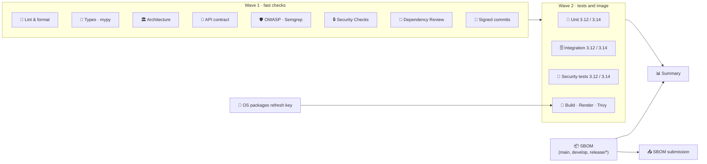

# CI/CD Pipeline Guide

Source of truth: [`.github/workflows/ci_cd_pipeline.yml`](../../.github/workflows/ci_cd_pipeline.yml)
and [`.github/workflows/snyk_review.yml`](../../.github/workflows/snyk_review.yml).
If this page and the workflow disagree, the workflow wins.

---

## When it runs

| Workflow | Triggers |
| --- | --- |
| **CI/CD Pipeline** | `push` to `main`, `develop`, `release/**`, `hotfix/**` (changes only to Markdown, `docs/**`, `CHANGELOG.md` or `LICENSE` are ignored); `pull_request` to `main` or `develop`; manual `workflow_dispatch` |
| **Snyk (weekly and releases)** | Mondays 06:00 UTC, pull requests to `main`, manual |
| **Mutation Score** ([`mutacion.yml`](../../.github/workflows/mutacion.yml)) | Mondays 02:00 UTC, manual. cosmic-ray over the scoring code ([`mutacion.toml`](../../mutacion.toml)); never blocks, the score goes to the job summary and the report is an artifact |

Dependabot (`.github/dependabot.yml`) opens weekly dependency PRs against `develop`,
with a cooldown for freshly published versions: 5 days for pip and GitHub Actions, 3 for
Docker (security updates do not wait).

---

## Stages

The pipeline runs in two waves. The fast checks go first; the tests and the image
build only start if none of them failed. The SBOM has no `needs`: it runs in parallel
with wave 1.



| Job | What it does | Reproduce locally |
| --- | --- | --- |
| 📝 **Lint & format** | `ruff check` and `ruff format --check` on `src/` and `tests/` (both block) | `ruff check src/ tests/ && ruff format --check src/ tests/` |
| 🔬 **Types (mypy)** | `mypy src/` | `mypy src/ --show-error-codes` |
| 🏛️ **Architecture** | `lint-imports` with the contracts in [`.importlinter`](../../.importlinter): layers, pure domain, module isolation | `lint-imports` |
| 📜 **API contract** | Generates the OpenAPI schema of the PR and of its base branch (no database or secrets needed) and compares them with oasdiff; breaking changes get the `api-breaking` label | `ENVIRONMENT=development python -c "import json; from main import app; print(json.dumps(app.openapi()))"` |
| 🛡️ **OWASP (Semgrep)** | Semgrep with the `p/owasp-top-ten` and `p/python` rulesets | — |
| 🔒 **Security Checks** | Bandit on `src/`; pip-audit on the installed dependencies (a vulnerability with a fix blocks); Gitleaks over the git history with [`.gitleaks.toml`](../../.gitleaks.toml), after a self-test that proves the rules load | `bandit -r src/` · `pip-audit` |
| 🔎 **Dependency Review** | Pull requests only: blocks a new dependency with a known vulnerability of moderate severity or higher | — |
| 🔏 **Signed commits** | Verifies every commit is GPG-signed (`scripts/verify-gpg-signatures.sh`, public key from the `GPG_PUBLIC_KEY` secret) | `git log --show-signature` |
| 🧪 **Unit** | `pytest tests/unit/` with branch coverage on Python 3.12 and 3.14; on 3.12 coverage must stay at 88 % or more | `pytest tests/unit/ -q` |
| 🗄️ **Integration** | `alembic upgrade head` against a PostgreSQL service, then `pytest tests/integration/` | `pytest tests/integration/` (needs PostgreSQL) |
| 🔐 **Security tests** | `pytest tests/security/`: CSRF, XSS, SQL injection, auth bypass, rate limiting | `pytest tests/security -n 2` |
| 📅 **OS packages refresh key** (`apt_refresh`) | Computes today's date (UTC) once and passes it as `APT_REFRESH` to the three build entries, so the `apt-get upgrade` layer is rebuilt once a day despite the cache and all three build the same image. No `needs`; `build` depends on it | — |
| 🐳 **Build** (matrix) | *Docker build*: production image from `docker/Dockerfile` plus the offline migration SQL (`alembic upgrade head --sql`). *Deploy like Render*: starts the image through `entrypoint.sh` against a real PostgreSQL and waits for `/health` to report the expected version. *Trivy*: image scan, uploaded as SARIF | `docker build -f docker/Dockerfile .` |
| 📦 **SBOM** | CycloneDX SBOM on `main`, `develop` and `release/*`; submitted to the GitHub dependency graph from `main` | `scripts/generate-sbom.sh` |
| 📊 **Summary** | One card per job in the run summary | — |

Both Python versions block: 3.14 is the production image (`python:3.14-slim`) and
3.12 the lowest version tested. A future version can be tried with
`experimental: true` in the matrix, which reports without blocking.

---

## Artifacts

`GitHub Actions → run → Artifacts`

| Artifact | Retention |
| --- | --- |
| `coverage-report-xml`, `coverage-report-html`, `coverage-integration-xml` | 7 days |
| `security-reports` (Bandit, pip-audit) | 30 days |
| `docker-image` | 7 days |
| `sbom-cyclonedx` | 90 days |

---

## Quick fixes

```bash
# Lint / format
ruff check --fix src/ tests/
ruff format src/ tests/

# Architecture contracts
lint-imports

# Tests
pytest tests/unit/
pytest tests/security -n 2
```

A vulnerable dependency is fixed by bumping its pin in `requirements.txt` (or
`requirements-dev.txt`) and regenerating the hashed lock files with
`scripts/freeze-requirements.sh` (needs Docker: it resolves inside the production
base image). `tests/unit/config/test_dependencias_con_hash.py` checks that the lock
pins the same versions as `requirements.txt`.

### GPG signing

Every commit must be signed.

```bash
gpg --list-secret-keys --keyid-format=long
git config --global user.signingkey YOUR_KEY_ID
git config --global commit.gpgsign true
gpg --armor --export YOUR_KEY_ID   # add it on GitHub: Settings → SSH and GPG keys
```

The CI imports the public key from the repository secret `GPG_PUBLIC_KEY`.

---

## Related scripts

- `scripts/verify-gpg-signatures.sh` — signature verification
- `scripts/generate-sbom.sh`, `scripts/submit-sbom-to-github.sh` — SBOM
- `scripts/freeze-requirements.sh` — hashed lock files (`requirements.lock`, `requirements-bootstrap.lock`)
- `.github/scripts/` — helpers used by the jobs (dependency install, summaries, gates, start like Render)
