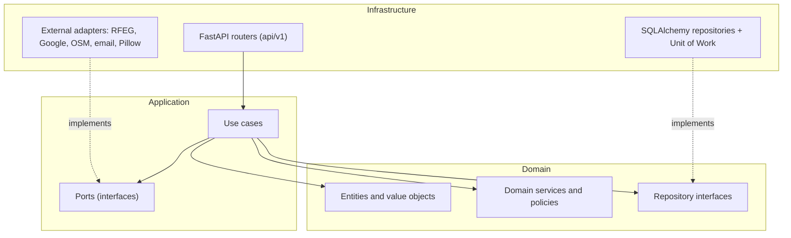

# Design Document - Comeback Golf

> **Version:** 2.82.1 · **Last updated:** 28 November 2026

---

## Summary

Comeback Golf is a platform for amateur golf among friends: tournaments in the Ryder format (two teams, match play), Stableford and Medal tournaments (stroke play), quick matches between friends, hole-by-hole scoring that keeps working without coverage, and a social layer (friends, profiles, activity feed). This repository is the **backend API**; the web app lives in [ComebackGolfWeb](https://github.com/agustinEDev/ComebackGolfWeb).

- **Stack:** Python (CI runs 3.12 and 3.14; the production image uses 3.14), FastAPI, SQLAlchemy 2 with imperative mapping, Alembic, PostgreSQL 15.
- **Architecture:** Clean Architecture + DDD, one bounded context per module, layer rules enforced by `import-linter` (`.importlinter`).
- **Production:** Docker image deployed on Render; `GET /health` reports the version and the deployed commit.

---

## Architecture

### Layers

**Rule:** dependencies point inward. The domain imports no framework or infrastructure code. Use cases call the port that performs a side effect explicitly; the unused domain events were removed (ADR-050). Dependency injection is wired in one place, `src/config/dependencies/` (composition root, ADR-012). Domain errors are translated to HTTP in one place (ADR-049).

### Modules

| Module | Responsibility | Doc |
|--------|----------------|-----|
| `user` | Accounts, authentication (password and Google), sessions per device, handicaps, avatars, admin | [user-management.md](modules/user-management.md) |
| `competition` | Tournaments (Ryder format, Stableford, Medal): enrollment, teams, draft, envelopes, schedule, scoring, standings | [competition-management.md](modules/competition-management.md) |
| `golf_course` | Course catalogue with approval workflow, tees and holes, hole maps from OpenStreetMap, RFEG course import | [RFEG_COURSE_IMPORT.md](RFEG_COURSE_IMPORT.md) |
| `quick_match` | Quick matches between friends (match play or stroke play, Medal or Stableford), with guests | — |
| `social` | Friendships and blocking, public profiles, profile photos, activity feed and achievements | — |
| `support` | Contact form, delivered by email | — |
| `shared` | Countries, shared value objects (match format, modality, play mode, scoring format), handicap and scoring calculators, HTTP middleware, email sending, logging | — |
| `config` | Settings, startup guards, rate limiting, CORS, CSRF, Sentry, background jobs, version | — |

Folder layout: [project-structure.md](project-structure.md). Database: [DATABASE_ERD.md](DATABASE_ERD.md).

### Patterns

- **Repository + Unit of Work** per module (ADR-005, ADR-006).
- **Value objects** for validation (ADR-002).
- **Ports and adapters** for external services (ADR-013).
- **One use case per operation** (ADR-011).
- **In-memory repositories** in `infrastructure/persistence/in_memory/` for fast unit tests.

---

## Key flows

### Sign-up

1. `RegisterUserUseCase` creates the user; the answer does not reveal whether the email already had an account (ADR-048).
2. The use case sends the verification email through the email port. The link carries a token that is stored hashed and expires.
3. `POST /api/v1/auth/verify-email` marks the email as verified (ADR-019, ADR-045).

### Login and session

1. `POST /api/v1/auth/login` checks the password (bcrypt) and the login brake per email and network (ADR-043).
2. The session belongs to a device (ADR-039, ADR-042): the access token goes in the `access_token` httpOnly cookie (15 min by default) and the refresh token in `refresh_token` (7 days by default), plus a signed CSRF token (ADR-040).
3. `POST /api/v1/auth/refresh-token` rotates the refresh token on every use and detects reuse.

### Handicap from the RFEG

`RFEGHandicapService` queries the public handicap search of the Spanish federation (`rfegolf.es`, 10 s timeout). If it cannot find the player, the handicap can be set by hand (`POST /api/v1/handicaps/update-manual`). Competitions can refresh all their players' handicaps, by hand or scheduled (ADR-014).

### Scoring without coverage

Scoring opens by itself at the hour of the session (06:00, 12:00 or 18:00 local time of the course) and the server decides with its own clock when each stroke arrives, so a stroke recorded offline is accepted when it reaches the server. Each hole carries the player's own score and the marker's; the hole is validated when both agree.

---

## External integrations

| Service | Used for | Code |
|---------|----------|------|
| RFEG | Player handicaps; course dataset import | `user/infrastructure/external/rfeg_handicap_service.py`, `golf_course/infrastructure/importers/` |
| Google OAuth | Sign in with Google, link and unlink | `user/infrastructure/external/google_oauth_service.py` |
| OpenStreetMap (Overpass, or a local extract) | Hole maps of golf courses (ODbL data) | `golf_course/infrastructure/osm/` |
| Mailgun → Resend → Brevo | Transactional email: Mailgun (EU) first; Resend as backup; Brevo only for emails without tokens or security notices, when the other two fail. Mailpit locally | `shared/infrastructure/email/envio_de_correo.py` |
| Sentry | Errors and performance | `src/config/sentry_config.py` |

---

## Background jobs

Tasks of the API process itself, started in the application lifespan (`main.py`). They do not run in the tests; each one says below where it runs.

| Job | What it does |
|-----|--------------|
| `CierreDeInscripciones` | Every hour, closes enrollments past the deadline (12:00 local time the day before). Production and Kind |
| `CierreDePartidasRapidas` | Every hour, closes quick matches nobody finished. Production and Kind |
| `LimpiezaDeSesiones` | Every hour, deletes old devices and refresh tokens. Production and Kind |
| `VigilanteDeActualizaciones` | Every minute, launches scheduled RFEG handicap refreshes and resumes interrupted ones. Production |
| `VigiaDeLaClaveDeBrevo` | Once a day, a small call that keeps the Brevo backup key alive (Brevo expires unused keys) and reports to a Sentry cron monitor. Production |

---

## Security

Summary of what exists in code; the detail is in [security/THREAT_MODEL.md](security/THREAT_MODEL.md), [KNOWN_SECURITY_ISSUES.md](KNOWN_SECURITY_ISSUES.md) and the ADRs.

- **Access control:** JWT in httpOnly cookies, sessions per device, refresh-token rotation, admin role (`users.is_admin`), organiser checks per competition.
- **CSRF:** signed token bound to the user, cookie + header (ADR-028, ADR-040, ADR-047).
- **Passwords:** 12 to 64 characters, blocklists, bcrypt with 12 rounds by default, last 5 not reusable.
- **Brute force:** login brake per email and network (ADR-043); rate limiting with slowapi, a default limit plus per-route limits, keyed by the real client IP behind the proxy (ADR-038, ADR-041).
- **Headers:** HSTS (2 years, subdomains), and the rest of the security headers set with the `secure` library (`src/shared/infrastructure/http/security_headers.py`).
- **Startup guards:** outside a declared development environment the app refuses to start with an empty, example or short `SECRET_KEY`, or with `TESTING=true` (`src/config/arranque_seguro.py`).
- **Logging:** security audit events in a durable security log, correlation IDs on every request, Sentry (ADR-051).
- **API docs:** `/docs`, `/redoc` and `/openapi.json` require HTTP Basic credentials (`DOCS_USERNAME`, `DOCS_PASSWORD`).

---

## Testing

| Suite | Folder | Collected (28 Nov 2026) |
|-------|--------|------------------------:|
| Unit | `tests/unit/` | 11,258 |
| Integration (PostgreSQL) | `tests/integration/` | 1,737 |
| Security | `tests/security/` | 67 |

Counted with `pytest --collect-only -q` per folder. CI runs each suite on Python 3.12 and 3.14; the unit job enforces a minimum coverage of 88 % on 3.12. See [tests/README.md](../tests/README.md) and ADR-003.

---

## Deployment and environments

- **Local, Docker Compose:** `docker/docker-compose.yml` (PostgreSQL 15 + API + Mailpit). See [docker/README.md](../docker/README.md).
- **Local, Kubernetes (Kind):** manifests and scripts in `k8s/`. See [k8s/README.md](../k8s/README.md).
- **Production:** Render, Docker runtime. See [DEPLOYMENT.md](../DEPLOYMENT.md), [RUNBOOK.md](RUNBOOK.md) and [MULTI_ENVIRONMENT_SETUP.md](MULTI_ENVIRONMENT_SETUP.md).

---

## CI/CD

GitHub Actions, workflow `.github/workflows/ci_cd_pipeline.yml`: unit, integration and security tests (Python 3.12 and 3.14), Bandit + pip-audit + Gitleaks, Ruff (lint and format), mypy, Docker build with a Render-like start and Trivy, dependency review, CycloneDX SBOM, signed-commit check, architecture contracts (import-linter), API contract check (oasdiff against the base branch) and OWASP Semgrep rules. A second workflow, `snyk_review.yml`, runs Snyk weekly and on releases. See [ci-cd/PIPELINE_GUIDE.md](ci-cd/PIPELINE_GUIDE.md) and ADR-021.

---

## ADR references

- **Foundation:** [001](architecture/decisions/ADR-001-clean-architecture.md), [004](architecture/decisions/ADR-004-tech-stack.md)
- **Patterns:** [002](architecture/decisions/ADR-002-value-objects.md), [005](architecture/decisions/ADR-005-repository-pattern.md), [006](architecture/decisions/ADR-006-unit-of-work-pattern.md), [011](architecture/decisions/ADR-011-application-layer-use-cases.md), [012](architecture/decisions/ADR-012-composition-root.md), [013](architecture/decisions/ADR-013-external-services-pattern.md), [046](architecture/decisions/ADR-046-allow-listed-imports-per-layer-and-password-hasher-port.md), [049](architecture/decisions/ADR-049-domain-errors-translated-to-http-in-one-place.md), [050](architecture/decisions/ADR-050-remove-unused-domain-events.md)
- **Infrastructure:** [009](architecture/decisions/ADR-009-docker-for-development-environment.md), [010](architecture/decisions/ADR-010-alembic-for-database-migrations.md), [016](architecture/decisions/ADR-016-render-deployment-strategy.md), [018](architecture/decisions/ADR-018-automated-database-migrations.md), [021](architecture/decisions/ADR-021-github-actions-ci-cd-pipeline.md)
- **Domain:** [014](architecture/decisions/ADR-014-handicap-management-system.md), [020](architecture/decisions/ADR-020-competition-module-domain-design.md), [026](architecture/decisions/ADR-026-playing-handicap-whs-calculation.md), [031](architecture/decisions/ADR-031-match-play-scoring-calculation.md), [032](architecture/decisions/ADR-032-golf-course-approval-workflow.md), [037](architecture/decisions/ADR-037-two-tier-handicap-session-round-model.md)
- **Security:** [023](architecture/decisions/ADR-023-security-strategy-owasp-compliance.md), [028](architecture/decisions/ADR-028-csrf-protection.md), [038](architecture/decisions/ADR-038-client-network-identity.md), [039](architecture/decisions/ADR-039-session-lifetime-per-device.md), [040](architecture/decisions/ADR-040-signed-csrf-token-bound-to-user.md), [041](architecture/decisions/ADR-041-real-client-ip-behind-cloudflare-and-default-rate-limit.md), [043](architecture/decisions/ADR-043-login-brake-per-email-and-network.md), [048](architecture/decisions/ADR-048-sign-up-without-enumeration-hashed-links-and-reset-brake.md), [051](architecture/decisions/ADR-051-standard-logging-and-durable-security-log.md)
