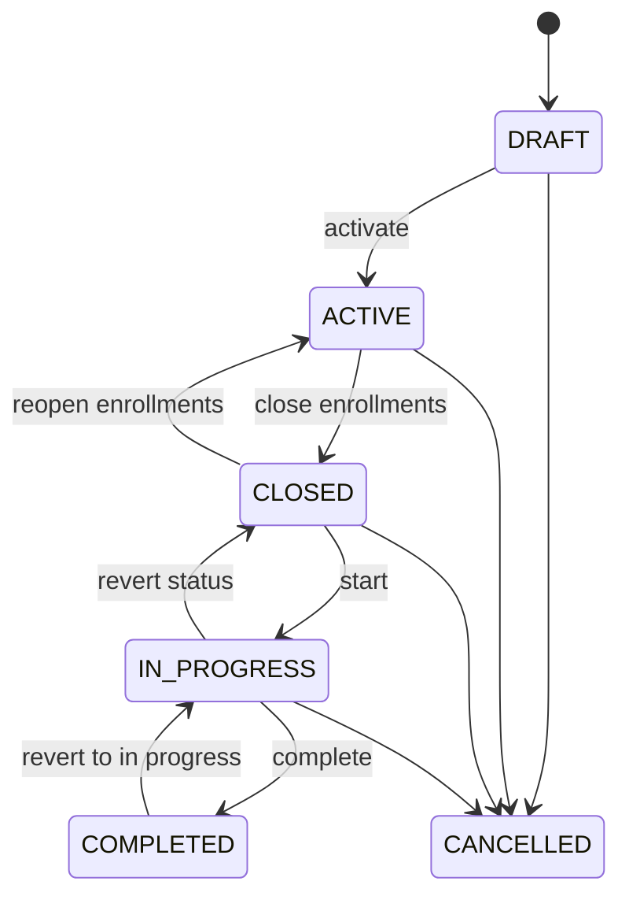

# Module: Competition Management

> **Version:** 2.82.1 · **Last updated:** 28 November 2026
> **Code:** `src/modules/competition/`

## 📋 Description

The competition module runs tournaments from creation to the final standings. Each competition has one **tournament type**:

| `TournamentType` | Modality | What it is |
|------------------|----------|------------|
| `RYDER_CUP` | Match play | Two teams in the Ryder format: sessions of singles, fourball and foursomes; each match gives points to its team |
| `STABLEFORD` | Stroke play | Individual Stableford, played in tee groups, with categories and an overall standing |
| `MEDAL` | Stroke play | Individual Medal (stroke play), same structure as Stableford |

It covers enrollment (requests, invitations, waiting lists), teams (automatic, manual or a captains' draft), the schedule (rounds/sessions, matches, tee groups and tee windows), handicaps (RFEG refresh, custom handicaps, WHS playing handicap), hole-by-hole scoring with marker validation, and the leaderboards. It follows the same Clean Architecture + DDD layout as the other modules.

**Full endpoint list:** [`docs/API.md`](../API.md) and the OpenAPI schema served at `/docs` (protected with HTTP Basic).

---

## 🗂️ Layout

```
src/modules/competition/
├── domain/
│   ├── entities/        # Aggregates and entities (see below)
│   ├── value_objects/   # Ids, statuses, setups, formats…
│   ├── services/        # Pure domain services (scoring, standings, tee windows…)
│   ├── policies/        # Time rules: enrollment opening/deadline, course time zone, draft order, marker chains
│   ├── repositories/    # Repository interfaces + CompetitionUnitOfWork interface
│   └── exceptions/
├── application/
│   ├── use_cases/       # One class per operation
│   ├── services/        # Application services shared by several use cases
│   ├── ports/           # Interfaces to other modules, email and activity publishers
│   ├── dto/
│   └── mappers/
└── infrastructure/
    ├── api/v1/          # FastAPI routers
    ├── persistence/     # sqlalchemy/ (mappers, repositories, UoW) and in_memory/ (test doubles)
    └── services/        # e.g. the competition time zone taken from its golf course
```

Routers registered in `main.py`: `competition_crud_routes`, `competition_state_routes`, `competition_golf_course_routes`, `enrollment_routes`, `invitation_routes`, `round_match_routes`, `draft_routes`, `envelope_routes`, `scoring_routes`, `tee_group_routes`, `tee_group_scoring_routes`.

---

## 🗃️ Domain Model

### Entities

| Entity | Role |
|--------|------|
| `Competition` | Aggregate root: name, dates, location (up to 3 countries), creator, status, play mode, max players, visibility, tournament type, Ryder setup (teams, captains, vice-captains) or stroke-play setup (categories, overall standing), enrollment opening schedule |
| `CompetitionGolfCourse` | Ordered link between a competition and its golf courses |
| `Enrollment` | A player in a competition: status, team, custom handicap, tees per course, name preference, handicap fixed at closing |
| `Invitation` | Invitation by user or by email, with its status and expiry |
| `TeamAssignment` | Team A / team B players and the assignment mode |
| `Draft` | The captains' draft room (snake order, turn, picks) |
| `Envelope` | A captain's envelope with the pairings for a session; both are revealed together |
| `Round` | A session: date, golf course, session type, match format, handicap allowance, status; in stroke play, its tee sheet |
| `Match` | A match of a session: players of each side, markers, status, decided result, withdrawals |
| `HoleScore` | Match-play score of one player on one hole (own score + marker score) |
| `Partida` | A stroke-play tee group that starts together |
| `GolpeDePartida` | What one player did on one hole of a tee group |
| `PlazaEnFranja` / `EsperaEnFranja` | A place, or a waiting-list entry, in a stroke-play tee window |
| `ActualizacionDeHandicaps` | One RFEG handicap refresh for a competition, with its origin and status |

### Statuses

| Value object | Values |
|--------------|--------|
| `CompetitionStatus` | `DRAFT`, `ACTIVE`, `CLOSED`, `IN_PROGRESS`, `COMPLETED`, `CANCELLED` |
| `EnrollmentStatus` | `REQUESTED`, `INVITED`, `APPROVED`, `REJECTED`, `CANCELLED`, `WITHDRAWN` |
| `InvitationStatus` | `PENDING`, `ACCEPTED`, `DECLINED`, `EXPIRED`, `NO_ROOM`, `CANCELLED`, `ON_HOLD` |
| `RoundStatus` | `PENDING_TEAMS`, `PENDING_MATCHES`, `SCHEDULED`, `IN_PROGRESS`, `COMPLETED` |
| `MatchStatus` | `SCHEDULED`, `IN_PROGRESS`, `COMPLETED`, `WALKOVER`, `CONCEDED` |
| `EstadoPartida` (tee group) | `SCHEDULED`, `IN_PROGRESS`, `COMPLETED` |
| `EstadoDeTarjeta` (stroke-play card) | `JUGANDO`, `ENTREGADA`, `RETIRADO`, `NO_PRESENTADO` |
| `DraftStatus` | `PENDING`, `IN_PROGRESS`, `COMPLETED` |
| `ValidationStatus` (hole) | `PENDING`, `MATCH`, `MISMATCH` |

Other enums: `Visibility` (`PRIVATE`, `PUBLIC`), `TeamAssignmentMode` (`AUTOMATIC`, `MANUAL`, `DRAFT`), `SessionType` (`MORNING`, `AFTERNOON`, `EVENING`), `HandicapMode` (`MATCH_PLAY`). Shared with other modules (`src/shared/domain/value_objects/`): `PlayMode` (`SCRATCH`, `HANDICAP`), `MatchFormat` (`SINGLES`, `FOURBALL`, `FOURSOMES`), `Modality` (`MATCH_PLAY`, `STROKE_PLAY`), `ScoringFormat` (`MEDAL`, `STABLEFORD`).

### Competition life cycle

Defined in `CompetitionStatus.can_transition_to()`:



`COMPLETED → IN_PROGRESS` is not in the generic transition table: it is a dedicated method, `Competition.revert_to_in_progress()`, behind `PUT /api/v1/competitions/{competition_id}/revert-to-in-progress`.

### Rules worth knowing

- **Name:** 3 to 100 characters (`CompetitionName`). **Players:** 2 to 200, 12 by default (`Competition`).
- **Enrollment deadline:** enrollments close at **12:00 local time of the course on the day before** the tournament, for every tournament type (`domain/policies/enrollment_deadline.py`; the time zone of the first course, `Europe/Madrid` when there is none). A background job closes them (`src/config/cierre_de_inscripciones.py`).
- **Scheduled opening:** a competition can open its enrollments by itself some days before the start (`domain/policies/enrollment_opening_service.py`).
- **Scoring opens by itself** at 06:00 (morning), 12:00 (afternoon) or 18:00 (evening) local time of the course, decided by the **server clock** when the stroke arrives, so strokes recorded offline are accepted when they reach the server (`domain/services/scoring_opening_service.py`). The organiser can still start a match earlier.
- **Default handicap allowance per format** (`MatchFormat`): singles 100 %, fourball 90 %, foursomes 50 % applied to the difference between the two sides. An allowance can be chosen by hand from 50 to 100 in steps of 5.
- **Playing handicap:** WHS calculation in `src/shared/domain/services/playing_handicap_calculator.py` (ADR-026, ADR-037).

### Domain services and policies

| File | What it decides |
|------|-----------------|
| `scoring_service.py` | What the Ryder competition adds to match play (points, decided matches) |
| `schedule_format_service.py` | The sequence of formats of the sessions |
| `envelope_reveal_service.py` | When the captains' envelopes open by themselves |
| `clasificacion.py`, `tarjeta_de_stroke_play.py` | Stroke-play standings and card totals from validated holes |
| `franjas_de_la_jornada.py`, `plazas_en_franjas.py`, `listas_de_espera.py` | Tee windows of a day, who can take a place and who gets it from the waiting list |
| `reparto_de_partidas.py`, `movimientos_de_partidas.py`, `plazo_de_partidas.py` | How players are split into tee groups, moved and reordered, and until when |
| `barra_del_jugador.py` | Which tees each player plays from |
| `refresco_de_handicaps_service.py`, `ventana_de_actualizacion.py`, `sin_actualizar_con_la_rfeg.py` | RFEG handicap refresh: who is asked, when a manual refresh is allowed, who was left without one |
| `competition_policy.py`, `location_builder.py` | Competition rules and the multi-country location |
| `policies/snake_draft_service.py`, `policies/marcadores_en_cadena.py`, `policies/zona_horaria.py` | Draft order, chained markers in a tee group, course time zone |

---

## 🎯 Use cases

There are 86 use-case files in `application/use_cases/`. By area:

| Area | Use cases |
|------|-----------|
| Competition | create, get, list, update, delete, summary, competition view |
| Life cycle | activate, close enrollments (by hand or past the deadline), reopen, start, complete, cancel, revert status, revert to in progress |
| Golf courses and tees | add, remove and reorder courses; tees per course and gender; enrollment tees |
| Enrollment | request, handle (approve/reject), cancel, withdraw, remove a player, custom handicap (set/remove), name preference |
| Invitations | send by user id or by email, respond, cancel, list mine, list a competition's |
| Teams and captains | assign teams, undo teams, name captains and vice-captains, fill a captain |
| Draft and envelopes | start the draft, make a pick, get the draft; submit, get, reveal and reset envelopes |
| Schedule (match play) | configure the schedule, create/update/delete a round, generate matches, reassign players, walkover, withdraw a player, update match status |
| Stroke play | tee windows and waiting lists, tee groups (organiser), record a hole, submit a card, standings, stroke-play settings |
| Scoring (match play) | scoring view, submit a hole score, submit the scorecard, concede, leaderboard |
| Handicaps | RFEG refresh, scheduled refresh, refresh status, players not updated, RFEG handicap of a profile |

---

## 📡 API

Routes live under `/api/v1/competitions`, `/api/v1/enrollments` and `/api/v1/invitations`. Operations per OpenAPI tag (counted from `app.openapi()`):

| Tag | Operations |
|-----|-----------:|
| Competitions | 6 |
| Competitions - State Transitions | 13 |
| Competitions - Golf Courses | 6 |
| Enrollments | 13 |
| Invitations | 6 |
| Competitions - Teams | 4 |
| Competitions - Draft | 3 |
| Competitions - Envelopes | 6 |
| Competitions - Rounds | 11 |
| Competitions - Matches | 5 |
| Competitions - Scoring | 7 |
| Competitions - Tee groups | 21 |

Countries (`/api/v1/countries`, 2 operations) belong to the shared kernel.

### Authorization

- Routes need an authenticated user (JWT in the `access_token` httpOnly cookie) unless the OpenAPI schema says otherwise.
- Organiser-only operations check the creator of the competition; admins (`users.is_admin`) can act on any competition.
- Who sees the list of entrants is decided in `application/services/quien_ve_los_inscritos.py`.
- Every route goes through the shared rate limiter (slowapi: a default limit plus per-route limits, ADR-041).

---

## 📊 Database

Tables of this module: `competitions`, `competition_golf_courses`, `competition_course_tees`, `enrollments`, `enrollment_course_tees`, `invitations`, `team_assignments`, `drafts`, `envelopes`, `rounds`, `matches`, `hole_scores`, `tee_groups`, `tee_group_players`, `tee_group_hole_scores`, `tee_window_places`, `tee_window_waits`, `withdrawn_tee_time_notices`, `handicap_updates`, `handicap_refreshes`, `handicap_update_schedules`, `handicap_update_emails`. Columns and relations: [`docs/DATABASE_ERD.md`](../DATABASE_ERD.md).

---

## 🧪 Testing

```bash
pytest tests/unit/modules/competition/    # unit tests, no database
pytest tests/integration/                 # endpoint tests (need PostgreSQL)
```

- Unit tests: `tests/unit/modules/competition/` (4,893 collected with `pytest --collect-only` on 28 Nov 2026).
- Endpoint tests: `tests/integration/api/v1/`, one file per area (for example `test_competition_endpoints.py`, `test_enrollment_endpoints.py`, `test_draft_endpoints.py`, `test_envelope_endpoints.py`, `test_franjas_endpoints.py`).
- In-memory repositories for unit tests: `src/modules/competition/infrastructure/persistence/in_memory/`.

---

## 🔗 ADRs

- [ADR-020: Competition module, domain design](../architecture/decisions/ADR-020-competition-module-domain-design.md)
- [ADR-025: Competition module evolution, v2.0.0](../architecture/decisions/ADR-025-competition-module-evolution-v2.0.md)
- [ADR-026: Playing handicap WHS calculation](../architecture/decisions/ADR-026-playing-handicap-whs-calculation.md)
- [ADR-031: Match play scoring calculation](../architecture/decisions/ADR-031-match-play-scoring-calculation.md)
- [ADR-037: Two-tier handicap architecture and session-based round model](../architecture/decisions/ADR-037-two-tier-handicap-session-round-model.md)
- [ADR-053: Invitations are answered from the signed-in player's inbox](../architecture/decisions/ADR-053-invitations-from-the-signed-in-inbox.md)
